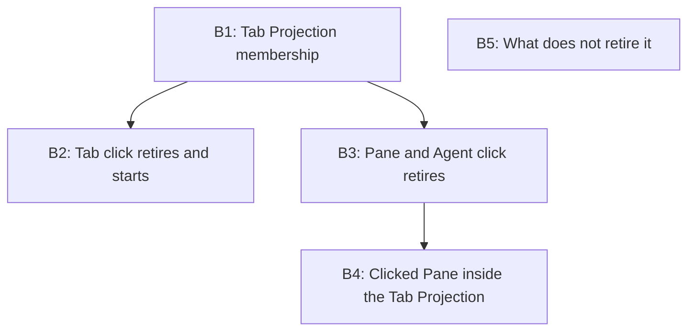

# Map: #74 Navigation click retires the Tab Projection

- stage: implementation

## Statements

- **S1**: «если мы кликаем на другую табу или пейн, те вскод табы в которых только один единственный пейн, который был открыт в результате клика на таб с несколькими пейнами, что бы тоже закрывался (либо если там есть например файл открытый и плюс наша таба с пейном, то наша таба бы там тоже закрывалась)»
  → After a click on another Tab or Pane, the Pane Editors that a multi-Pane Tab click opened close; a group that held only such a Pane Editor goes away, and in a group with a file only the Pane Editor closes.
- **S2**: «Q1 a,b,c; Q2 a; Q3 да»
  → Triggers: Tab, Pane and Agent rows. Only the Pane Editors of the last Tab click are cleaned up. File editors are never closed.
- **S3**: «я бы все таки сделал такой эксплисит клик как тоже маркер того, что я хочу что бы только этот пейн был виден»
  → A click on a Pane inside the Tab Projection means "show only this Pane".
- **S4**: «6 - а. 7 - отдельная фича.»
  → A dragged Pane Editor stays in the Tab Projection. Live tracking of the Tab's layout is a separate feature (#75).
- **S5**: «закрываются только те пейны, которые появились в группе в результате клика на табу с несколькими пейнами»
  → Only Pane Editors the multi-Pane Tab click put into a group belong to the Tab Projection.
- **S6**: «9 да 10 да 8 а»
  → A single-Pane Tab click retires and starts nothing; a Pane Editor the click recreated is a member; a Pane opens after the cleanup in the active remaining group.
- **S7**: «я бы ожидал, что клик на d оставит только первую группу и откроет д там»
  → Clicking a member that is alone in its own group recreates it in the remaining group.
- **S8**: «12 а, 13 а»
  → A repeated click on the same Tab keeps the Tab Projection; it does not survive Reload Window.
- **S9**: «если я кликнул на пейн клторый уже стоит на своем месте, то его не надо пересоздавать» + «да, так»
  → The clicked member stays put when its group holds something else or no other group is left (S1–S4 scenarios in ADR 0018).

## Boxes

### B1: Tab Projection membership

- parent: —
- status: closed
- serves: S2, S4, S5, S6, S8
- touches: `modules/pane-editors` (PaneTerminalSurfaceManager)

The Pane Editors that the latest multi-Pane Tab click created or recreated in their groups. Membership follows the Pane Editor, not its group.

#### Decisions

- **D1**: Members are the Pane Editors the click created or recreated; one found in place keeps its membership (from S5, S6; was Q5, Q10, Q12).
- **D2**: Dragging keeps membership (from S4; was Q6).
- **D3**: Memory only; lost on Reload Window (from S8; was Q13).
  - before → after: after Reload Window, the next click closes nothing.
- **D4**: Live layout tracking is out of scope, #75 (from S4; was Q7).

#### Readiness intent questions (astra-arch-74-1; not approved amendments)

- **I1 — decided by the owner: yes (recommended answer).** Confirm that the latest projection is window-wide, including members from a previously selected Session. Recommended: yes; selecting a Session alone still does not retire it. Inconvenient case: project Session A → select Session B → click B's Pane: before, A's Pane Editors remain; after, A's members close before B's target opens. Same Pane IDs in different Sessions are not the same target.

### B2: Tab click retires and starts

- parent: B1
- status: closed
- serves: S1, S2, S6, S8
- touches: `features/open-tab`, `modules/pane-editors`

A Tab click closes the previous members that are not Panes of the clicked Tab, then projects as in ADR 0017; its created Pane Editors become the new members.

#### Decisions

- **D5**: Switching Tab 13 → Tab 12 closes Tab 13's members instead of keeping them behind (from S1).
  - before → after: `[p6D] [p6E]` then Tab 12 → was `[p6D p69] [p6E p6C] [p6A] [p6B]`, now `[p69] [p6C] [p6A] [p6B]`.

#### Readiness intent questions (astra-arch-74-1; not approved amendments)

- **I2 — decided by the design owner: recommended answer.** Singleton rows already use Pane navigation, but a direct one-Pane `herdr.openTab` call is supported by existing tests. Recommended: keep its whole-grid layout behavior but retire prior membership and start none, matching S6/ADR 0018. Inconvenient case: direct singleton command → later Pane click: the literal draft would close its newly created Pane Editor as a member; the recommendation leaves it as an ordinary Pane Editor. Owner must reconcile this with the draft's “no special branch”.

### B3: Pane and Agent click retires

- parent: B1
- status: closed
- serves: S1, S2, S6
- touches: `views/sidebar/panes` (`herdr.openPane`), `features/reveal-pane`, `modules/pane-editors`

A Pane row or Agent row click closes every member, then opens the Pane as today (reveal where it is, or create in the active remaining group).

#### Decisions

- **D6**: Only Pane and Agent rows retire. Create Pane, Split, Create Space and Run npm Script open Pane Editors without retiring (from S2; was Q1).
- **D7**: Cleanup happens before opening (from S6; was Q8).
  - before → after: `[file B] [D]`, click C → `[file C]`.

#### Readiness intent questions (astra-arch-74-1; not approved amendments)

- **I3 — decided by the design owner: recommended answer.** Confirm that a failed Pane/Agent retirement relinquishes membership even for surviving editors. Recommended: retain the draft's clear-first/no-rollback rule, report failure, and do not silently retry survivors on the next click. Inconvenient case: cleanup closes B but fails on D → D remains, now ordinary; next navigation no longer cleans D up.
- **I4 — decided by the design owner: recommended answer.** Confirm that empty-group disappearance relies on `workbench.editor.closeEmptyGroups` being enabled. Recommended: respect VS Code's setting, do not force-close groups or change settings. Inconvenient case with it disabled: `[file B][D]` → click C closes B/D but can leave empty cells and opens C in the then-active group, rather than promising `[file C]`. Verify normal enabled-setting ordering before delegation; no unconditional group-absence wait.
- **I5 — decided by the design owner: recommended answer.** Confirm inheritance of #19's exclusion of overlapping user clicks. Recommended: no queue/latest-wins mechanism in #74. Inconvenient case: start Tab navigation, click a Pane before it completes → the earlier Tab operation may resume and lay out/add members after the newer click; only settled sequential navigation is promised.

#### Final-review intent question (arch-fit-74-2)

- **I7 — decided by the owner (2026-10-11): a Pane Editor moved into the Panel stays open and does not block retirement; retirement closes only members in the editor grid.** Original question: A projection member moved into the Panel remains managed but unbound. Before #74 it obstructed only a Tab projection containing that Pane; after #74 every unrelated Tab click waits for its binding and fails repeatedly. A Pane/Agent click clears membership but itself fails before opening the target; a later click can proceed. Recommended: do not let an out-of-grid terminal poison unrelated navigation. Owner/user must settle whether it remains open, membership after retirement/re-entry, and the unbound target case. Bound-only retirement is a candidate amendment, not approved: unbound does not uniquely mean Panel, and retaining unbound membership on the Tab path can cause later cleanup after rebinding. See `final-review/answers-2.md`. #73's orphan-repair exclusion alone does not approve this expanded failure.

### B4: Clicked Pane inside the Tab Projection

- parent: B3
- status: closed
- serves: S3, S7, S9
- touches: `modules/pane-editors`

The other members close first. The clicked one stays if its group holds something else or no other group is left; otherwise it is recreated in the active remaining group. Afterwards it is not a member.

#### Decisions

- **D8**: S1 `[file B][D]` click B → `[file B]`; S2 click D → `[file D]`; S3 `[B][D]` click D → `[D]`; S4 `[file][B][D]` click B → `[file B]` (from S3, S7, S9; was Q4, Q11, Q14).

#### Readiness intent questions (astra-arch-74-1; not approved amendments)

- **I6 — decided by the design owner: recommended answer.** Show the already documented recreation cost on this box. Recommended: accept ADR 0018's consequence explicitly for S2/S4: before, clicking the existing target preserves its terminal and local scrollback; after, the target is recreated in the remaining group, losing VS Code-side scrollback and reconnecting to Herdr. The Herdr Pane/process remains untouched.

### B5: What does not retire it

- parent: —
- status: closed
- serves: S2
- touches: —

Focusing a Pane Editor in the editor area, selecting a Space or a Session.
